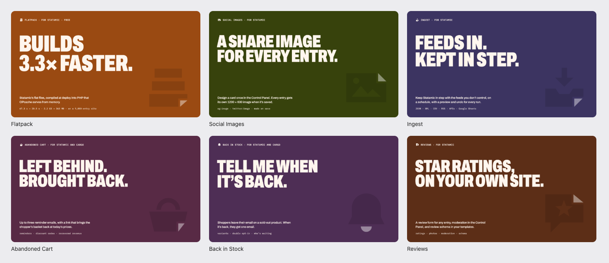

# The 1994 house style for Marketplace images

Every addon's listing looks like it belongs to the same family, and no addon looks like anyone else's. Two kinds of image: **the cover is a colour field**, and **the images inside the listing are white sheets**. The frame is shared: colour, type, the meta line, the grid. What's drawn on the sheets comes from each addon's own world.

The code is in `house.mjs` (colours, type, page shell, isometric drawing helpers, rendering). Each addon's `tools/` imports it.

## Colour

Each addon owns one colour, its mark colour, used full bleed on its cover and as the only accent on its sheets. Everything else is ink and white.

| Token | Value | Use |
|---|---|---|
| `ink` | `#141414` | Text and line drawings on sheets |
| `paper` | `#FFFFFF` | Sheet backgrounds |
| `muted` | `#6B6B6B` | Secondary text on sheets |
| `hairline` | `#E4E4E4` | Row dividers |
| `statamicGrey` | `#CFC9C0` | "Without the addon" in comparisons |
| cover text | `#FFF6EE` | Text on a colour field |
| addon colour | its mark colour | Cover background; the one accent on sheets |

`ramp(colour)` gives the addon's lighter and darker steps: `shade` for the mark behind the cover claim, `light`/`mid`/`main` for the faces of highlighted isometric parts.

**Open:** Abandoned Cart (`#582A45`), Back in Stock (`#4E2E55`) and Ingest (`#3C3461`) are too close to tell apart side by side. One or two of them should move before their covers are redrawn.

## Type

| Role | Face | Setting |
|---|---|---|
| Display (cover claim, sheet titles) | Archivo 900, width 68 to 72% | Uppercase, tight (−0.02em), lines of 2 to 4 words |
| Body (ledes, captions in prose) | Archivo 500 | Sentence case, 19 to 25px |
| Labels (meta line, captions, figures, code) | IBM Plex Mono 500/600 | Uppercase for the meta line, as written for commands |

No serif, no italics.

## The cover: a colour field

- The addon colour, full bleed.
- The meta line, top: the mark in cream, then `Name · for Statamic` (`and Cargo`, `· free` where true).
- One claim, as large as fits (it shrinks itself to clear the mark): what the addon does, in under six words. A real number when there is one (Flatpack: "Builds 3.3× faster."), never an invented one.
- A one-sentence lede, and a mono line of facts or figures under it.
- The addon's own mark, whole and large, bottom right, one shade darker than the field, folded corner included.

## The sheets: white, framed the same, drawn in the addon's own language

Every sheet is white, with the meta line on top: the mark in its colour, `Name · for Statamic`, and on the right a part number and topic (`FP-03 · how much it helps`). A display title top left, a lede under it, the picture on the right or below. The addon colour is the only accent.

What the picture shows belongs to the addon, never borrowed from another:

| Addon | Its language | Example |
|---|---|---|
| Flatpack | Flat-pack assembly: isometric boards, numbered build steps, measured bars | `flatpack/03-deeper.png` |
| Social Images | The share cards it makes, shown as neutral link previews | `preview/social-images-sheet.png` |
| Ingest | Feeds arriving and runs (yet to draw) | |
| Cargo addons | Baskets, products and emails (yet to draw) | |

Patterns any addon may use, in its own language:

- **The number is the picture.** Two bars, without and with the addon, bottom-aligned, the figures above them. Only for real measurements, with the source in the footer.
- **A grid** of real values with hairline rules and meters.
- **Steps,** numbered only when they really are a sequence, with a mono caption under each.
- **What's in the box** as the last image: the addon's parts, lettered, with requirements and licence in a footer line.

Link previews and other UI are drawn generically: never a real platform's look or logo. Every measured figure says where it came from in the footer. The isometric helpers in `house.mjs` (`box`, `arrow`, `stepMark`) are Flatpack's language; other addons draw their own.

## Files

Per addon, in its folder: `cover-1600x900.png`, `01-*.png` to `06-*.png` (each with a `-2x`), `addon-icon.*`, `description.md`, `charts/` for README and docs images, `tools/` for the scripts. `preview/` here is a contact sheet of the style across addons, drawn by `family.mjs`.
